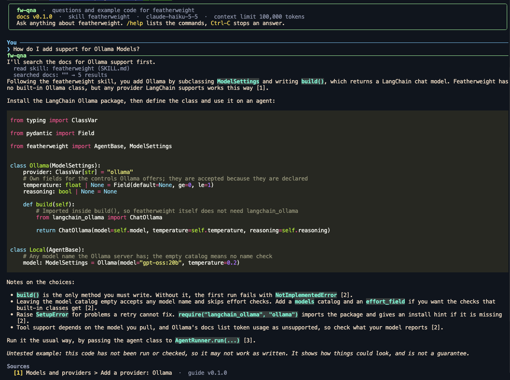

# fw-qna

A terminal chat that answers questions about [featherweight](https://github.com/aadhithya/featherweight) from its own
documentation, and writes example code for it.

It does two jobs. It is a quick way to learn the framework: ask "how do I run jobs on a worker?" and get an answer with
links to the pages it came from. And it is a demonstration: the chat agent is built on featherweight itself, and uses its
streaming agents, tools, skills and run log.

**Version 1.0.0.** MIT license.



*A real answer. The agent read featherweight's skill and searched the docs, then wrote a short commented example, marked
its sources with `[1]`, `[2]`, `[3]` and ended with the warning that the code is untested.*

## What it does

- **Answers from the docs, with citations.** Every answer is based on a search of the documentation, and the sources it
  used are listed under it, with links to the page and section on GitHub, at the release you asked about.
- **Knows which version it is talking about.** Docs are indexed per release tag (`v0.1.0`, ...), and a chat answers from
  one release at a time: the latest by default, or another with `/version`.
- **Writes example code, and says it is untested.** When you ask how to build something, it drafts a minimal, commented
  example from the documented building blocks, even when the docs do not cover that exact thing (a Postgres job queue, say).
  It marks what comes from the docs and what is its own design, never invents featherweight API, and ends every answer
  with code with a warning that the code has not been run or checked. The code shows how things could look. It is not a
  promise that it works.
- **Uses featherweight's own skill.** Each release ships a skill that teaches coding agents how to build with it. Ingestion
  pulls it with the docs, and the chat agent reads it before writing code, so the skill is part of what the demo shows.
- **Runs the embedding model locally.** Documents and questions are embedded with EmbeddingGemma 2 through Ollama. Only the
  chat model, Claude Haiku 5.5, is a hosted service.
- **Keeps long chats going.** The whole conversation stays in memory for the session. When it nears the context limit, the
  oldest turns move to a temporary archive that the model can search, so nothing is lost.

## Quick start

You need Docker and `make`. Nothing else is installed on your machine: everything runs in containers.

```
cp .env.example .env      # put your Anthropic API key in it (or export ANTHROPIC_API_KEY)
make ingest REF=v0.1.0    # starts Ollama, pulls the embedding model (once), indexes the docs and the skill
make chat
```

`make ingest` clones the release tag from [featherweight on GitHub](https://github.com/aadhithya/featherweight) (public,
no login needed). The first run downloads the Ollama image and the embedding model, and indexing `v0.1.0` takes about two
minutes on a laptop CPU. Running it again with nothing changed takes a few seconds. Only release tags (`vX.Y.Z`) are
indexed: a branch or a commit is refused, so the index always matches what was published.

Each chat turn calls Claude, which is billed to your Anthropic account. Indexing and searching are free and local.

Good first questions: "how do I define an agent?", "what does check_output do?", "how do I build a Redis job queue?", and
"hi", which gets a reply without a search.

## Using the chat

The screen has a banner, then each turn: a **You** rule, then an **fw-qna** rule with a spinner that says what is being
searched, the answer rendered as markdown while it streams, and the sources under it. Citations in the text look like
`[2]`; the sources list shows only what the answer cited. A number that no search returned is flagged as unverified, and
results that were found but not cited are shown dimmed. The model draws diagrams as plain text, since a terminal cannot
render Mermaid.

| Command | What it does |
|---|---|
| `/help` | list the commands |
| `/sources` | every source cited so far in this conversation, and the skill files read |
| `/version [tag\|latest]` | show the indexed releases, or answer from another one (its skill comes with it) |
| `/context [tokens]` | show how full the context is, or set its limit (kept in `config.yaml`) |
| `/save [name]` | save the last code block of the last answer to `saved/` in your data directory |
| `/copy` | copy the last code block to the clipboard, in terminals that support OSC 52 (iTerm2, kitty, WezTerm, tmux, VS Code) |
| `/clear` | start the conversation again |
| `/exit` | leave (Ctrl-D works too) |

**Ctrl-C** stops the answer that is being written. What was written stays in the conversation, so you can correct the model.

## Make targets

| Target | What it does |
|---|---|
| `make up` | start Ollama and pull the embedding model (once) |
| `make ingest REF=v0.1.0` | index a release and its skill. `SOURCE=<git url or local clone>` changes where it is read from |
| `make versions` | list the indexed releases |
| `make drop REF=v0.1.0` | remove a release, with its skill, from the index |
| `make search Q="..."` | try the search with no chat model. `ARGS="--keywords JobWorker"` adds exact names to match |
| `make chat` | chat about the docs |
| `make check-embeddings` | check that the real embedding model gives sane vectors |
| `make down` | stop Ollama (your data stays) |

If `make up` says the model needs a newer Ollama, run `docker compose pull ollama`; `make up` does this for you.

## Settings and your data

Everything the app keeps is in one directory: `./data`, or the directory set by `FW_QNA_DATA`. That is where you control it.

```
data/
  fw-qna/
    index/            the LanceDB index of every release you ingested
    skills/v0.1.0/    that release's skill, and where it came from
    config.yaml       your settings
    saved/            code saved with /save
    runs.db           featherweight's run log (metadata only, no message content)
  ollama/             the downloaded embedding model
```

**`config.yaml`** holds the context limit (100,000 tokens by default) and the colors of the interface, as hex codes. The
defaults ship with the package in [`defaults.yaml`](src/fw_qna/defaults.yaml), which is commented. The first `make chat`
copies it into your data directory, and it is read every time the chat starts. Edit it, or change the limit in the chat
with `/context 20000`, which keeps your comments. A value that is not valid falls back to its default, a file that is not
valid YAML is reported with its path, and deleting the file gets you a fresh copy.

## How it works

```
make ingest                                              make chat
  a release tag on GitHub                                  you ──▶ the terminal (Rich, prompt_toolkit)
   ├─ docs, changelog, examples                                         │
   │    ─▶ clean, parse, chunk                                          ▼
   │    ─▶ embed (Ollama: EmbeddingGemma 2)            a featherweight streaming agent (Claude Haiku 5.5)
   │    ─▶ LanceDB (vectors and keywords)                 ├─ search_docs     ─▶ hybrid search of the index
   └─ skills/                                             ├─ get_skill       ─▶ the release's skill
        ─▶ data/skills/<tag>/                             └─ search_history  ─▶ turns moved to the archive
```

| Stage | What it does | Built with |
|---|---|---|
| Source | exports the docs, changelog, examples and skill from one release tag | `git` |
| Parse and chunk | strips navigation and badges, splits at headings, then at paragraphs to about 1,500 characters. A code block is never split. The changelog is one chunk per release and an example one chunk per directory. Each chunk keeps its page, section, layer and a link | LlamaIndex |
| Embed | `title: <section> (<layer>) \| text: ...` for documents and `task: search result \| query: ...` for questions, as the model was trained. The 768 numbers are cut to 512 (Matryoshka) and normalized | EmbeddingGemma 2 270M on Ollama |
| Index | one table for every release, filtered by version. Re-ingesting an unchanged release embeds nothing | LanceDB |
| Retrieve | BM25 keywords and vector similarity, merged with reciprocal rank fusion. Exact names go in a `keywords` argument, and at most two whole examples come back per search | LanceDB |
| Answer | a strict system prompt, three tools, and the conversation kept as LangChain messages | featherweight, Claude Haiku 5.5 |
| Screen | streaming markdown, sources, commands, hex-coded colors | Rich, prompt_toolkit |

**featherweight features it uses:** a `StreamingAgent` (no output type, so the prompt and the tools keep it grounded);
LangChain tools; Agent Skills through `skills=[...]`, which adds `get_skill`; `AgentRunner` with a `SqliteDatabase` run
log; `ChatInput.from_langchain` and `run.new_messages` to keep the conversation; `run.cancel()` for Ctrl-C; and the token
usage on each reply to know how full the context is.

The design, the decisions and the reasons behind them are in [docs/PRD.md](docs/PRD.md).

## Limits

- **The code is not tested.** The model cannot run it, and it says so. Treat it as a sketch.
- **The warning and the citations come from the prompt.** Nothing enforces them, so a model can still forget one. Sources
  are always built from what the search tool returned, so a link is never made up, but a model can use a result without
  citing it.
- **Only release tags are indexed**, and only the docs, changelog, examples and skill. Not the source code, issues or pull
  requests.
- **Conversations are not saved** between sessions.
- **The embedding model runs on CPU in Docker**, so it is slower than a native install, but fast enough for this corpus.

## Development

Everything that runs code runs in Docker, so nothing is installed on your machine. You need Docker, `make` and
[pre-commit](https://pre-commit.com). There is no CI: the checks run locally, before each commit.

```
make hooks   # once per clone: installs the pre-commit hooks (ruff, tests, commit message)
make check   # lint, format check and tests
make fmt     # fix formatting
```

The tests use a scripted fake chat model and a fake embedder, so they never call a real model and cost nothing. Commits are
[conventional commits](https://www.conventionalcommits.org). Work happens on a branch per issue, in a git worktree
(`.worktrees/`).

```
src/fw_qna/
  ingest/        source (git), clean, chunk
  embedder.py    EmbeddingGemma 2 through Ollama
  index.py       the LanceDB index
  retrieval.py   hybrid search
  search_tool.py the search_docs tool and its numbered citations
  skills.py      the release's skills, next to the index
  conversation.py  the history, the archive and search_history
  agent.py       the featherweight agent and its prompt
  session.py     one chat session, as events
  ui.py, chat.py, theme.py   the terminal
  config.py, defaults.yaml   settings
```

Where the data directory comes from, for the `fw-qna` command: `--data-dir`, then `FW_QNA_HOME`, then the path remembered by
`fw-qna init`, then `~/.fw-qna`. With `make` it is always `./data`.

## License

MIT. See [LICENSE](LICENSE).
